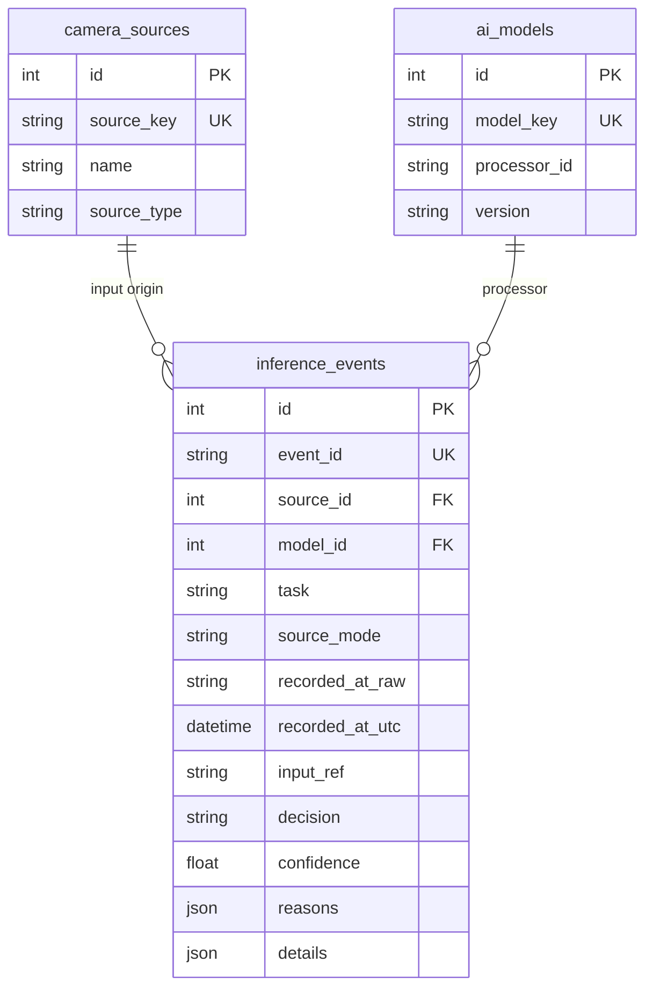

## 1. 오늘의 목표

1일차에는 교과 9의 OCR 검사 기록과 교과 10의 동작인식 결과를 `InferenceEvent`라는 
공통 JSON으로 변환하고, FastAPI와 웹 화면에서 조회했습니다.

하지만 결과는 아직 `handoff/records/`의 JSON 파일에만 있습니다. 
제품 검사 결과가 수천 건, 수만 건으로 늘어나면 필요한 기록을 찾아 수정하거나 
종류별로 통계를 계산하는 작업을 JSON 파일만으로 관리하기가 어려워집니다.

오늘은 **1일차에 만든 플랫폼을 그대로 이어서 데이터베이스 기능을 추가**합니다. 
먼저 ERD로 저장할 데이터의 관계를 설계하고, PostgreSQL에 실제 테이블을 만듭니다. SQLAlchemy를 이용해 Python에서 데이터를 저장·조회하고, FastAPI와 웹 화면에도 연결합니다.

### 이번 수업에서 사용할 데이터베이스 기술을 알아봅니다

**1. ERD(Entity Relationship Diagram) — 데이터베이스 설계도**

데이터를 저장하기 전에 **어떤 테이블이 필요하고, 테이블끼리 어떻게 연결되는지 그림으로 설계하는 것**입니다.

예를 들어 검사 장치, AI 모델, 검사 결과를 각각 테이블로 만들고 이들의 관계를 정의합니다.

**2. PostgreSQL — 데이터를 저장하고 관리하는 데이터베이스**

앞에서 배운 Oracle Database와 마찬가지로 SQL을 사용하는 **관계형 데이터베이스 관리 시스템(RDBMS)**입니다.

PostgreSQL은 무료 오픈소스이며, 일반적인 테이블 데이터뿐 아니라 JSON 데이터도 효율적으로 관리할 수 있어 AI 서비스 개발에도 널리 활용됩니다.

기존에 배운 `SELECT`, `INSERT`, `UPDATE`, `DELETE` 등의 SQL 개념을 그대로 활용할 수 있습니다. 
다만 일부 SQL 문법과 기능은 Oracle과 다릅니다.

**3. SQLAlchemy — Python과 데이터베이스를 연결하는 도구**

Python 코드에서 PostgreSQL의 데이터를 저장하고 조회할 수 있도록 도와주는 라이브러리입니다.

특히 **ORM(Object Relational Mapping)** 기능을 사용하면 Python 클래스를 데이터베이스 테이블과 연결하여, SQL을 매번 직접 작성하지 않고도 데이터를 다룰 수 있습니다.

### 세 가지 기술의 역할

```
ERD
→ 어떤 테이블을 만들지 설계

PostgreSQL
→ 설계한 테이블을 실제로 만들고 데이터 저장

SQLAlchemy
→ Python에서 테이블의 데이터를 저장·조회

FastAPI
→ 저장된 데이터를 웹 화면에 전달
```

**핵심:** ERD는 설계도, PostgreSQL은 실제 데이터 저장소, SQLAlchemy는 Python과 데이터베이스를 연결하는 도구입니다.

오늘 수업을 마치면 다음 내용을 직접 실행할 수 있어야 합니다.

- `camera_sources`, `ai_models`, `inference_events` 세 테이블이 필요한 이유와 PK·FK 관계를 이해합니다.
- PostgreSQL 서버와 교과 13 전용 데이터베이스를 준비합니다.
- SQLAlchemy ORM 클래스로 테이블을 생성하고 PostgreSQL에 연결합니다.
- **1일차의 실제 공통 `InferenceEvent` 기록을 재사용하여 DB에 저장**합니다.
- 같은 기록을 다시 가져와도 중복 저장되지 않게 합니다.
- FastAPI의 DB API로 기록을 조회하고, 수동 실습 기록 한 건을 생성·수정·삭제합니다.
- `/db` 웹 화면에서 PostgreSQL에 저장된 제조 검사·동작인식 결과를 확인합니다.
- 자동 테스트, README, Git 커밋으로 오늘 작업을 정리합니다.

**오늘의 완성 기준:** 전날 인수한 교과 9·10의 기록이 빠짐없이 PostgreSQL에 저장되고, 
DB 조회 화면과 CRUD API가 정상 동작해야 합니다. 기록 개수는 학생별로 다를 수 있습니다.

---

## 2. 오늘 수업의 전체 흐름

![[Pasted image 20261024213235.png]]

오늘은 **PostgreSQL에서 데이터를 저장하고 조회하는 것**에 집중합니다. AI 모델을 다시 학습하거나 카메라를 실행하지 않습니다. Redis·Celery는 3일차, Docker·Compose는 7일차에 추가합니다.

---

## 3. 실습 전에 알아야 할 핵심

### 3.1. 1일차에 만든 파일을 그대로 사용합니다

다음 파일이 있어야 합니다.

```text
subject13_ai_platform/
├── app/
│   ├── __init__.py
│   ├── schemas.py         # InferenceEvent
│   ├── records.py         # load_events()
│   └── main.py            # 기존 FastAPI
├── scripts/
│   └── 01_import_results.py
├── web/
│   └── index.html
├── tests/
│   └── test_platform.py
├── handoff/
│   └── records/
│       ├── inspection_history.json
│       └── action_jobs.json
├── requirements.txt
├── .gitignore
└── README.md
```

1일차에서는 교과 9의 OCR 검사 결과와 교과 10의 동작인식 결과를 가져와 `handoff/records/` 
폴더에 JSON 파일로 저장했습니다.

2일차에서는 **1일차에 저장한 두 JSON 파일을 그대로 사용합니다.**

만약 `handoff/records/` 폴더에 파일이 없다면, 1일차에 작성한 다음 명령어를 다시 실행하여 
검사 결과를 가져옵니다.

```
python scripts/01_import_results.py
```

정상적으로 실행되면 다음 두 파일이 생성됩니다.

```
handoff/records/
├── inspection_history.json   ← 교과 9 OCR 검사 결과
└── action_jobs.json          ← 교과 10 동작인식 결과
```

단, 교과 9·10의 기존 결과가 없다면 1일차에서 안내한 `handoff/provided/` 폴더에 제공된 JSON 자료를 먼저 준비해야 합니다.

**오늘은 이 두 JSON 파일에 저장된 검사 결과를 사용하므로, 이전 AI 모델을 다시 실행하거나 
원본 영상을 가져올 필요가 없습니다.**

### 3.2. JSON 파일과 PostgreSQL은 무엇이 다른가요?

1일차에는 전체 JSON 파일을 읽은 뒤 Python에서 목록을 만들었습니다. 

오늘은 데이터를 **테이블의 행(Row)**으로 저장합니다. 그러면 특정 작업의 기록만 선택하거나, 
여러 테이블을 연결해서 조회하고, 개별 기록을 수정할 수 있습니다.

![[Pasted image 20261024213951.png]]

오늘 만든 DB는 1일차의 JSON 원본을 지우거나 대체하지 않습니다. 원본은 그대로 보존하고 **DB에 별도로 옮겨 저장**합니다.

### 3.3. ERD·테이블·PK·FK를 먼저 이해합니다

- **테이블(Table):** 같은 종류의 데이터를 모아 놓은 표입니다.
- **행(Row):** 검사 결과 한 건처럼 하나의 데이터를 뜻합니다.
- **열(Column):** 결과의 `decision`, `confidence` 같은 항목입니다.
- **PK(Primary Key):** 한 행을 다른 행과 구별하는 기본키입니다.
- **FK(Foreign Key):** 다른 테이블의 PK를 참조하는 외래키입니다.
- **ERD:** 테이블과 관계를 그림으로 설계한 것입니다.

![[Pasted image 20261024215254.png]]

### [[정규화]] 바로가기


예를 들어 같은 검사 출처에서 여러 제품을 검사할 수 있고, 같은 추론 모듈로 여러 결과를 만들 수 있습니다. 그래서 입력 출처와 추론 모듈을 매 검사 결과마다 반복 기록하지 않고 **서로 다른 테이블로 나누어 연결**합니다.

### 3.4. `camera_sources`와 `ai_models`는 무엇을 저장하나요?

2일차에서는 1일차에 가져온 교과 9·10의 검사 결과를 PostgreSQL 데이터베이스에 저장합니다.

이때 **검사 결과뿐 아니라 어떤 입력 데이터를 사용했고, 어떤 AI 처리 방법으로 검사했는지도 
함께 관리**하기 위해 테이블을 나눕니다.

|테이블|저장하는 정보|예시|
|---|---|---|
|`camera_sources`|검사에 사용한 입력 데이터의 출처|교과 9의 이미지, 교과 10의 영상|
|`ai_models`|검사에 사용한 AI 모델 또는 처리 모듈 정보|OCR 검사 모듈, Action Recognition|
|`inference_results`|실제 검사 결과|OK, NG, UNKNOWN|

현재는 저장된 이미지와 영상의 검사 결과를 사용하므로, `camera_sources`에 실제 카메라 장비나 IP 주소를 등록하는 것은 아닙니다.

또한 `ai_models`에는 모델 파일 자체가 아니라 **1일차 JSON에서 확인한 처리 모듈과 버전 정보**를 저장합니다.

즉, 오늘은 **어떤 데이터를 어떤 방법으로 검사했고, 결과가 무엇인지** 데이터베이스에서 연결하여 관리하는 구조를 만드는 것입니다.

실제 카메라를 연결하는 기능은 4일차에 추가합니다.

### 3.5. ORM과 CRUD는 무엇인가요?

**ORM(Object-Relational Mapping)**은 Python 클래스를 데이터베이스 테이블과 연결해 주는 방식입니다. 오늘은 SQLAlchemy로 ORM 클래스를 작성합니다.

**CRUD**는 데이터에 수행하는 네 가지 기본 작업입니다.

| 이름 | 의미 | 오늘 실습 |
|---|---|---|
| Create | 새 데이터 만들기 | 수동 실습 이벤트 1건 생성 |
| Read | 데이터 읽기 | 전체 목록·상세 기록·통계 조회 |
| Update | 데이터 바꾸기 | 수동 실습 이벤트의 판정 수정 |
| Delete | 데이터 삭제하기 | 수동 실습 이벤트 1건 삭제 |

**기존 교과 9·10에서 가져온 기록은 오늘 수정하거나 삭제하지 않습니다.** CRUD 학습용으로 별도 생성한 `manual_entry` 데이터만 수정·삭제하도록 코드를 작성합니다.

### 3.6. 기존 검사 결과와 시간을 그대로 보존합니다

2일차에서는 1일차에 가져온 JSON 데이터를 데이터베이스에 저장합니다. 이때 **원본에 없는 정보를 임의로 만들거나 검사 결과를 변경하지 않습니다.**

**① 검사 결과와 신뢰도**

- 교과 9의 OCR 결과에 `confidence`(예측 신뢰도)가 없다면 `NULL`(기록된 값 없음)로 저장합니다.
    
- 교과 10에서 동작을 예측하지 못한 `UNKNOWN` 또는 `NO_PREDICTION`은 불량(`NG`)으로 바꾸지 않습니다.
    

**② 검사 날짜와 시간**

기존 JSON에는 검사 시간이 기록되어 있지만, 일부는 어느 나라 시간인지 알 수 없습니다.

그래서 두 가지 방법으로 저장합니다.

|DB 항목|저장하는 내용|
|---|---|
|`recorded_at_raw`|원본 JSON에 기록된 날짜와 시간을 그대로 저장|
|`recorded_at_utc`|시간대가 확인된 경우에만 세계 공통 기준 시간(UTC)으로 변환하여 저장|

예를 들어 `2026-10-24 14:00+09:00`은 한국시간임을 알 수 있으므로 UTC로 변환할 수 있습니다.

반면 `2026-10-24 14:00`처럼 시간대가 없다면 정확한 UTC를 알 수 없으므로 `recorded_at_utc`에는 `NULL`을 저장합니다.

**핵심:** 기존 검사 결과와 시간 정보를 임의로 변경하지 않고, 확인할 수 있는 정보만 정확하게 데이터베이스에 저장합니다.

### 3.7. 왜 `.venv`를 유지하나요?

교과 13의 개발 PC에서는 1일차에 만든 Python 가상환경을 계속 사용합니다. PostgreSQL은 **별도 데이터베이스 서버**이고, Python은 여기에 접속합니다. 오늘은 Docker로 교체하지 않으며, 7일차에 이 애플리케이션과 DB 등을 Docker Compose로 묶는 방법을 배웁니다.

---

## 4. 오늘 사용할 기술 스택

| 기술 | 오늘 실습에서 담당하는 역할 |
|---|---|
| Python·`.venv` | 기존 교과 13 프로젝트를 계속 개발 |
| PostgreSQL | 검사 기록과 관계형 데이터를 실제 저장 |
| SQL · ERD | 테이블의 키와 관계를 설계하고 조회 |
| SQLAlchemy 2.x | Python 클래스와 PostgreSQL 테이블 연결 |
| Psycopg 3 | SQLAlchemy가 PostgreSQL과 통신하는 드라이버 |
| python-dotenv | 비밀번호 등 환경설정을 `.env`에서 읽음 |
| Pydantic | DB CRUD에 전달할 JSON의 자료형 검사 |
| FastAPI | 저장 결과 조회·생성·수정·삭제 API 제공 |
| HTML · JavaScript | PostgreSQL 기록을 웹브라우저에서 조회 |
| Pytest · HTTPX | 기존 기능과 DB 추가 기능을 자동 검증 |
| Git | 2일차 결과를 기존 저장소에 커밋 |

---

# 5. 처음부터 끝까지 따라 하는 상세 실습

## PART 1. 1일차 프로젝트를 다시 열고 준비합니다

### 실습 1. 전날 작성한 프로젝트와 결과를 확인합니다

새 폴더를 만들지 않습니다. WSL Ubuntu 터미널에서 1일차와 동일한 프로젝트로 이동합니다.

```bash
cd ~/ai_vision/subject13_ai_platform
source .venv/bin/activate
pwd
which python
```

`pwd`에는 `subject13_ai_platform`, `which python`에는 해당 프로젝트의 `.venv/bin/python` 경로가 포함되어 있어야 합니다.

전날 만든 기록도 확인합니다.

```bash
ls -lh handoff/records/inspection_history.json handoff/records/action_jobs.json
python -m pytest -q
```

1일차 코드를 그대로 작성했다면 이전 테스트 **12개**가 정상 통과해야 합니다. 파일이 없으면 1일차 교재의 결과 인수 과정을 완료한 뒤 계속 진행합니다.

### 실습 2. 2일차 폴더와 새 파일의 위치를 확인합니다

현재 사용 중인 폴더에 `docs`가 있는지 확인하고 없을 때만 생성합니다.

```bash
mkdir -p docs
```

오늘은 다음 파일을 **추가**합니다.

```text
app/
├── db.py                 # DB 설정·Session
├── models.py             # ORM 테이블 3개
├── repository.py         # 기존 기록을 DB에 저장
├── db_schemas.py         # CRUD 입력 JSON
└── db_api.py             # DB CRUD API

scripts/
├── 02_create_tables.py
└── 03_import_records_to_db.py

web/
└── db.html               # 2일차 DB 조회 화면

tests/
└── test_db.py            # 2일차 DB 테스트

docs/
└── day02_erd.md          # 테이블 관계 정리

.env.example              # 공유 가능한 DB 설정 예시
.env                      # 내 PC 비밀번호 포함 (Git 제외)
```

`app/records.py`, `web/index.html`, `tests/test_platform.py`는 오늘 다시 작성하지 않습니다.

## 2일차에 작성할 주요 파일과 역할

2일차에서는 1일차에 만든 AI 플랫폼에 PostgreSQL 데이터베이스를 연결합니다. 아래 파일들은 데이터베이스 설정, 테이블 생성, 데이터 저장, 조회, 테스트를 각각 담당합니다.

| 구분                                                         | 파일명                                  | 역할                            | 쉽게 이해하기                              |
| ---------------------------------------------------------- | ------------------------------------ | ----------------------------- | ------------------------------------ |
| DB 연결                                                      | `app/db.py`                          | PostgreSQL 연결 설정 및 Session 관리 | Python 프로그램이 데이터베이스에 접속하도록 연결        |
| DB테이블 <br>정의                                               | `app/models.py`                      | SQLAlchemy ORM으로 테이블 3개 정의    | 어떤 데이터를 어떤 항목으로 저장할지 설계              |
| DB데이터 <br>처리                                             . | `app/repository.py`                  | 기존 기록 저장 및 DB 데이터 처리          | 검사 결과를 데이터베이스에 넣고 가져오는 기능            |
| 데이터 <br>형식 정의                                              | `app/db_schemas.py`                  | CRUD 요청·응답 JSON 구조 정의         | DB에 전달할 데이터의 형식과 규칙 설정               |
| DB API                                                     | `app/db_api.py`                      | FastAPI의 CRUD API 구현          | 웹에서 데이터 저장·조회·수정·삭제 요청 처리            |
| 테이블 <br>생성                                                 | `scripts/02_create_tables.py`        | 정의한 테이블을 PostgreSQL에 생성       | 설계한 데이터 저장 공간을 실제 DB에 만듦             |
| 기존 데이터 가져오기                                                | `scripts/03_import_records_to_db.py` | 1일차 JSON 기록을 PostgreSQL로 저장   | 기존 검사 결과를 JSON 파일에서 DB로 옮김           |
| DB 웹 화면                                                    | `web/db.html`                        | 데이터베이스 조회 화면 구현               | 저장된 검사 결과를 웹브라우저에서 확인                |
| 자동 테스트                                                     | `tests/test_db.py`                   | DB 연결 및 저장·조회 기능 테스트          | 데이터베이스 기능이 정상적으로 작동하는지 자동 검사         |
| DB 설계 <br>문서                                               | `docs/day02_erd.md`                  | 테이블 구조와 관계(ERD) 기록            | 테이블끼리 어떤 데이터로 연결되는지 설명               |
| 환경설정 <br>예시                                                | `.env.example`                       | 공유 가능한 DB 연결 설정 예시            | 다른 학생도 참고할 수 있는 설정 양식                |
| 실제 <br>환경설정                                                | `.env`                               | 실제 DB 접속 정보와 비밀번호 저장          | 내 PC에서 사용할 DB 접속 정보를 보관하며 Git 업로드 제외 |

### 파일들이 연결되는 순서

![[Pasted image 20261024221953.png]]

```
1일차 JSON 검사 결과
         ↓
.env / db.py
DB 연결 준비
         ↓
models.py
테이블 구조 정의
         ↓
02_create_tables.py
PostgreSQL 테이블 생성
         ↓
03_import_records_to_db.py
기존 JSON 기록을 DB에 저장
         ↓
repository.py
DB 데이터 처리
         ↓
db_schemas.py + db_api.py
데이터 형식 검증 및 CRUD API 제공
         ↓
db.html
웹브라우저에서 결과 조회
         ↓
test_db.py
전체 DB 기능 자동 검증
```

핵심: 1일차에는 JSON 파일을 Python으로 읽어 웹에 보여주었다면, 2일차에는 JSON 기록을 PostgreSQL에 저장하고 FastAPI를 통해 데이터베이스에서 조회하는 기능을 만드는 것입니다.

---

## PART 2. ERD를 직접 설계합니다

### 실습 3. 세 테이블의 관계를 설계합니다

다음과 같이 생각해 봅니다.

```text
입력 출처(camera_sources) 1개
          │
          └─────────┐
                    │ 여러 검사 결과
                    ▼
           inference_events
                    ▲
                    │ 여러 검사 결과
          ┌─────────┘
          │
추론 모듈(ai_models) 1개
```

- `camera_sources.id`는 출처 테이블의 **PK**입니다.
- `ai_models.id`는 처리 모듈 테이블의 **PK**입니다.
- `inference_events.source_id`는 `camera_sources.id`를 참조하는 **FK**입니다.
- `inference_events.model_id`는 `ai_models.id`를 참조하는 **FK**입니다.
- `inference_events.event_id`에는 1일차의 고유 이벤트 ID를 저장하고 **UNIQUE**를 설정합니다.

예를 들어 한 건의 검사 결과가 `inspection:...`이라고 해도 어떤 이미지 출처에서 만들어졌고 어떤 OCR 검사 모듈을 사용했는지 FK로 연결할 수 있습니다.

![[Pasted image 20261024222447.png]]

**의사코드로 ERD 읽기**

```text
교과 9 결과인가, 교과 10 결과인가 확인
        ↓
입력 출처 행(camera_sources)을 찾기
        ↓
처리 모듈 행(ai_models)을 찾기
        ↓
이벤트 행(inference_events) 만들기
        ↓
출처 ID·모듈 ID를 FK로 연결
        ↓
원본 결과의 예측·판정·시간·이유 보관
```

이제 설계 내용을 문서로 저장합니다. GitHub의 Markdown에서는 Mermaid ERD도 확인할 수 있습니다.

**파일: `docs/day02_erd.md`**

````markdown
# 교과 13 · 2일차 ERD



- `camera_sources`: 현재는 실제 하드웨어 카메라가 아니라 저장 이미지·영상의 **입력 출처**입니다.
- `ai_models`: 원본 결과에 남은 **처리 모듈과 버전**을 기록하며, 실제 가중치 파일을 의미하지 않습니다.
- `inference_events`: 결과 한 건과 출처·모듈의 외래키를 연결합니다.
- `event_id`는 원래 교과 9·10 결과의 식별자로, 중복 가져오기를 막는 데 사용합니다.
- `recorded_at_raw`는 시간대가 불명확한 원본 시각도 그대로 보관합니다.
- 전체 필드 목록은 `app/models.py`의 ORM 클래스를 기준으로 확인합니다.
````

실제 PostgreSQL에 테이블을 만드는 코드는 다음 PART에서 작성합니다.

---

## PART 3. PostgreSQL 서버와 개발 환경을 준비합니다

### 실습 4. PostgreSQL을 설치하고 서버를 실행합니다

터미널에서 PostgreSQL 클라이언트가 있는지 확인합니다.

```bash
psql --version
```

`psql: command not found`가 나타나거나 PostgreSQL이 설치되어 있지 않으면 Ubuntu에서 설치합니다. **교육장에 기존 PostgreSQL 서버가 제공되었다면 설치하지 않고 해당 서버의 접속정보를 사용**합니다.

```bash
sudo apt update
sudo apt install -y postgresql postgresql-client
```

WSL Ubuntu에서 PostgreSQL 서버를 시작합니다.

```bash
sudo service postgresql start
pg_isready -h 127.0.0.1 -p 5432
```

정상이라면 `accepting connections`가 나타납니다. 이 메시지는 PostgreSQL 서버가 접속을 받을 수 있다는 뜻이며, **아직 로그인 계정과 비밀번호를 검사한 것은 아닙니다.**

수업 환경에 `systemd`가 활성화되어 있다면 `sudo systemctl start postgresql`을 사용할 수도 있습니다. 재부팅 후 서버가 꺼져 있다면 위 시작 명령을 다시 실행합니다.

### 실습 5. 전용 DB 계정과 데이터베이스를 만듭니다

기본 관리자 `postgres` 계정으로 애플리케이션을 실행하지 않고, **교과 13에서만 사용할 일반 계정**을 만듭니다.

```bash
sudo -u postgres createuser --pwprompt subject13_user
```

비밀번호 입력을 요청하면 수업용으로 사용할 암호를 정하고 두 번 입력합니다. **암호는 GitHub나 README에 기록하지 않습니다.** 계정이 이미 존재하면 새로 만들지 않아도 됩니다.

다음으로 학생 전용 데이터베이스를 만듭니다.

```bash
sudo -u postgres createdb --owner=subject13_user subject13_platform
```

데이터베이스가 이미 있다면 중복 생성 오류가 날 수 있습니다. 기존 DB를 삭제하지 말고 `psql`로 확인합니다.

이제 만든 계정으로 접속해 봅니다.

```bash
psql -h 127.0.0.1 -p 5432 -U subject13_user -d subject13_platform
```

비밀번호를 입력하고 다음과 같이 나타나면 연결된 것입니다.

```text
subject13_platform=>
```

SQL을 실행하여 현재 DB를 확인합니다.

```sql
SELECT current_database(), current_user;
```

결과에서 데이터베이스가 `subject13_platform`, 사용자가 `subject13_user`인지 확인한 뒤 `\q`로 종료합니다.

> PostgreSQL 사용 권한이나 교육장 네트워크 정책이 다르다면 제공된 사용자·DB 이름을 사용합니다. **이후 `.env` 설정을 같은 값으로 맞추면 됩니다.**

### 실습 6. 1일차 `requirements.txt`에 DB 패키지를 추가합니다

1일차의 FastAPI·Uvicorn·Pydantic·HTTPX·Pytest 버전을 삭제하지 않고 아래의 **세 줄을 맨 아래에 추가**합니다.

```text
SQLAlchemy>=2.0,<3
psycopg[binary]>=3.2,<4
python-dotenv>=1.0,<2
```

SQLAlchemy는 ORM, Psycopg는 PostgreSQL 연결 드라이버, python-dotenv는 `.env` 설정을 읽는 데 사용합니다.

기존 `(.venv)`가 활성화된 상태에서 다음을 실행합니다.

```bash
python -m pip install -r requirements.txt
python -m pip show SQLAlchemy psycopg python-dotenv
```

설치된 패키지 정보가 표시되면 정상입니다. **기존 `.venv`는 그대로 유지합니다.**

### 실습 7. 접속 설정을 `.env`로 분리합니다

DB 비밀번호를 Python 코드에 직접 작성하면 Git에 잘못 업로드할 수 있습니다. 그래서 코드에는 환경변수 이름만 사용하고, 실제 접속정보는 `.env`에 저장합니다.

**의사코드**

```text
.env.example 생성
        ↓
.env로 복사
        ↓
DB 이름·계정·비밀번호 입력
        ↓
Python이 설정을 읽어 PostgreSQL 접속
        ↓
Git에는 .env가 올라가지 않도록 확인
```

**파일: `.env.example`**

```dotenv
# 실제 설정 파일은 이 파일을 .env로 복사하여 작성합니다.
DB_HOST=127.0.0.1
DB_PORT=5432
DB_NAME=subject13_platform
DB_USER=subject13_user
DB_PASSWORD=REPLACE_WITH_YOUR_PASSWORD
```

위 파일을 저장한 다음 다음 명령으로 `.env`를 만듭니다.

```bash
cp .env.example .env
```

VS Code에서 `.env`를 열고 `DB_PASSWORD=REPLACE_WITH_YOUR_PASSWORD`의 오른쪽 값을 **실습 5에서 설정한 실제 비밀번호**로 변경합니다. 기관에서 이미 만든 서버를 사용한다면 `DB_HOST`, `DB_PORT`, `DB_NAME`, `DB_USER`도 실제 정보에 맞게 수정합니다.

**주의:** `.env.example`은 빈 예시 설정으로 Git에 올려도 되지만, **비밀번호가 들어 있는 `.env`는 Git에 올리지 않습니다.** 기존 1일차 `.gitignore`에 `.env.*` 패턴이 있으므로, `.env.example`만 예외로 추가하는 방법은 마지막에 확인합니다.

---

## PART 4. SQLAlchemy로 DB 연결과 테이블을 작성합니다

### 실습 8. 데이터베이스 연결 파일을 작성합니다

`app/db.py`는 PostgreSQL 접속주소를 만들고, 다른 Python 파일들이 같은 방식으로 DB에 접근할 수 있도록 `engine`과 `Session`을 제공합니다.

**의사코드**

```text
.env의 DB 설정 읽기
      ↓
PostgreSQL 접속 URL 만들기
      ↓
SQLAlchemy Engine 생성
      ↓
DB Session을 만드는 SessionLocal 준비
      ↓
FastAPI에서 요청마다 Session 사용
      ↓
요청이 끝나면 Session 종료
```

`engine`은 DB와 통신하기 위한 연결 설정이며, `Session`은 하나의 요청이나 작업에서 DB 데이터를 다룰 때 사용하는 객체입니다. **Engine을 만들었다고 DB 서버가 자동 실행되는 것은 아닙니다.**

**파일: `app/db.py`**

```python
"""2일차: DB 접속 설정과 SQLAlchemy Session."""
import os
from pathlib import Path

from dotenv import load_dotenv
from sqlalchemy import create_engine
from sqlalchemy.engine import URL
from sqlalchemy.orm import DeclarativeBase, sessionmaker

ROOT = Path(__file__).resolve().parents[1]
load_dotenv(ROOT / '.env')


def get_database_url():
    """수업에서는 PostgreSQL, 자동 테스트에서는 별도 SQLite DB 사용 가능."""
    override = os.getenv('DATABASE_URL')
    if override:
        return override
    return URL.create(
        'postgresql+psycopg',
        username=os.getenv('DB_USER', 'subject13_user'),
        password=os.getenv('DB_PASSWORD', ''),
        host=os.getenv('DB_HOST', '127.0.0.1'),
        port=int(os.getenv('DB_PORT', '5432')),
        database=os.getenv('DB_NAME', 'subject13_platform'),
    )


engine = create_engine(get_database_url(), pool_pre_ping=True)
SessionLocal = sessionmaker(bind=engine, autoflush=False, expire_on_commit=False)


class Base(DeclarativeBase):
    pass


def get_db():
    with SessionLocal() as session:
        yield session
```

코드에서 `URL.create()`를 사용하는 이유는 비밀번호에 `@` 같은 특수문자가 있어도 URL 문자열을 직접 이어 붙이지 않고 안전하게 전달하기 위해서입니다.

`get_db()`의 `yield`는 FastAPI가 요청을 처리하는 동안 Session을 제공한 뒤 종료하도록 합니다. 테스트에서는 `DATABASE_URL`을 이용해 PostgreSQL 대신 별도의 시험용 DB를 선택할 수 있습니다. **실제 수업의 데이터 저장 대상은 PostgreSQL**입니다.

### 실습 9. 세 개의 ORM 테이블 클래스를 작성합니다

앞에서 작성한 ERD를 Python 클래스로 표현합니다. 클래스는 다음처럼 1일차의 이벤트 정보와 연결됩니다.

```text
CameraSource (입력 출처)
   id PK
       │
       └──── source_id FK ──┐
                           ▼
                     InferenceEventRow
                           ▲
       ┌──── model_id FK ───┘
       │
   id PK
AIModel (추론 모듈)
```

**의사코드**

```text
camera_sources 클래스 정의
       ↓
ai_models 클래스 정의
       ↓
inference_events 클래스 정의
       ↓
source_id → camera_sources.id FK 지정
model_id → ai_models.id FK 지정
       ↓
판정·신뢰도·원본 시간·이유·상세정보 저장 칼럼 추가
```

**파일: `app/models.py`**

```python
"""2일차: 입력 출처, 추론 모듈, 추론 이벤트의 테이블 구조."""
from datetime import datetime
from typing import Any

from sqlalchemy import DateTime, Float, ForeignKey, Integer, JSON, String, Text, func
from sqlalchemy.dialects.postgresql import JSONB
from sqlalchemy.orm import Mapped, mapped_column, relationship

from app.db import Base

# PostgreSQL에서는 JSONB, SQLite 테스트에서는 일반 JSON 형식을 사용합니다.
JSON_DOCUMENT = JSON().with_variant(JSONB(), 'postgresql')


class CameraSource(Base):
    __tablename__ = 'camera_sources'
    id: Mapped[int] = mapped_column(Integer, primary_key=True)
    source_key: Mapped[str] = mapped_column(String(100), unique=True, nullable=False)
    name: Mapped[str] = mapped_column(String(150), nullable=False)
    source_type: Mapped[str] = mapped_column(String(30), nullable=False)
    events: Mapped[list['InferenceEventRow']] = relationship(back_populates='source')


class AIModel(Base):
    __tablename__ = 'ai_models'
    id: Mapped[int] = mapped_column(Integer, primary_key=True)
    model_key: Mapped[str] = mapped_column(String(220), unique=True, nullable=False)
    processor_id: Mapped[str] = mapped_column(String(150), nullable=False)
    version: Mapped[str | None] = mapped_column(String(100))
    events: Mapped[list['InferenceEventRow']] = relationship(back_populates='model')


class InferenceEventRow(Base):
    __tablename__ = 'inference_events'
    id: Mapped[int] = mapped_column(Integer, primary_key=True)
    event_id: Mapped[str] = mapped_column(String(140), unique=True, index=True, nullable=False)
    source_id: Mapped[int] = mapped_column(ForeignKey('camera_sources.id'), nullable=False)
    model_id: Mapped[int] = mapped_column(ForeignKey('ai_models.id'), nullable=False)
    task: Mapped[str] = mapped_column(String(20), nullable=False)
    source_mode: Mapped[str] = mapped_column(String(30), nullable=False)
    source_project: Mapped[str] = mapped_column(String(100), nullable=False)
    source_path: Mapped[str] = mapped_column(Text, nullable=False)
    recorded_at_raw: Mapped[str] = mapped_column(String(48), nullable=False)
    recorded_at_utc: Mapped[datetime | None] = mapped_column(DateTime(timezone=True))
    input_ref: Mapped[str] = mapped_column(Text, nullable=False)
    predicted_label: Mapped[str | None] = mapped_column(Text)
    expected_label: Mapped[str | None] = mapped_column(Text)
    confidence: Mapped[float | None] = mapped_column(Float)
    decision: Mapped[str] = mapped_column(String(10), nullable=False)
    reasons: Mapped[list[str]] = mapped_column(JSON_DOCUMENT, nullable=False)
    details: Mapped[dict[str, Any]] = mapped_column(JSON_DOCUMENT, nullable=False)
    created_at: Mapped[datetime] = mapped_column(DateTime(timezone=True), server_default=func.now(), nullable=False)

    source: Mapped[CameraSource] = relationship(back_populates='events')
    model: Mapped[AIModel] = relationship(back_populates='events')
```

**코드에서 확인할 내용**

- `CameraSource`와 `AIModel`의 `id`는 PK입니다. `source_key`와 `model_key`는 중복 등록을 막는 고유값입니다.
- `InferenceEventRow`는 1일차 `InferenceEvent`를 DB 테이블로 저장하는 ORM 클래스입니다. 1일차 Pydantic 클래스와 **역할이 다릅니다.**
- `source_id`, `model_id`는 FK이며, `relationship()`은 관련된 출처·모듈 행을 Python에서 함께 사용할 수 있게 합니다.
- `confidence`는 `nullable`이므로 없는 값은 SQL `NULL`로 저장합니다.
- `reasons`, `details`는 PostgreSQL에서 **JSONB**로 저장합니다. DB를 SQLite로 격리하는 자동 테스트에서는 일반 JSON 형태를 사용합니다.
- `recorded_at_raw`는 원본 시각, `recorded_at_utc`는 시간대 정보가 명확한 경우에만 변환한 UTC 시각입니다.
- `created_at`은 **DB에 행을 저장한 시각**이므로 AI가 처음 검사한 시각과 혼동하지 않습니다.

### 실습 10. 테이블 생성 스크립트를 작성하고 실행합니다

ORM 클래스를 작성했다고 DB에 테이블이 자동으로 만들어지는 것은 아닙니다. `Base.metadata.create_all()`을 실행해 PostgreSQL에 실제 테이블을 만듭니다.

**의사코드**

```text
DB 연결 설정 확인
      ↓
ORM 테이블 클래스 불러오기
      ↓
PostgreSQL에 테이블이 없으면 생성
      ↓
생성된 테이블 이름 출력
```

**파일: `scripts/02_create_tables.py`**

```python
"""PostgreSQL에 3개 테이블을 처음 생성합니다."""
from sqlalchemy import inspect
from app.db import Base, engine
from app import models  # noqa: F401: 세 테이블을 Base에 등록합니다.


def main():
    Base.metadata.create_all(bind=engine)
    print('생성/확인된 테이블:', ', '.join(sorted(inspect(engine).get_table_names())))
    print('참고: create_all은 기존 테이블을 삭제하거나 컬럼 구조를 변경하지 않습니다.')


if __name__ == '__main__':
    main()
```

프로젝트의 최상위 폴더에서 실행합니다. `python -m` 형식으로 실행하면 `app` 패키지를 찾기 쉽습니다.

```bash
python -m scripts.02_create_tables
```

정상 결과에는 다음 세 테이블이 포함되어야 합니다.

```text
생성/확인된 테이블: ai_models, camera_sources, inference_events
```

PostgreSQL에서 직접 확인할 수도 있습니다.

```bash
psql -h 127.0.0.1 -U subject13_user -d subject13_platform
```

접속 후 다음을 입력합니다.

```sql
\dt
\d inference_events
```

`inference_events`의 `source_id`와 `model_id`가 FK인지, `event_id`가 UNIQUE인지 확인합니다. `\q`로 종료합니다.

**중요:** `create_all()`은 처음 테이블을 생성할 때 사용합니다. 이미 생성한 테이블에 새로운 컬럼을 추가하는 DB 마이그레이션 기능은 아닙니다. 이후 일차에서 테이블이 변경되면 데이터 보존을 고려하여 별도의 마이그레이션이 필요합니다. **수업 중 테이블을 임의로 삭제해 다시 만드는 방식은 사용하지 않습니다.**

---

## PART 5. 1일차 실제 결과를 PostgreSQL에 저장합니다

### 실습 11. 기존 공통 이벤트를 DB 행으로 변환하는 코드를 작성합니다

1일차에는 `app.records.load_events()`를 호출하면 교과 9·10 기록을 공통 `InferenceEvent` 목록으로 받을 수 있었습니다. **이 함수를 다시 작성하지 않습니다.**

오늘 추가할 `app/repository.py`는 다음 작업을 담당합니다.

```text
1일차 load_events()로 실제 공통 기록 읽기
       ↓
각 event_id가 DB에 이미 있는지 확인
       ↓
없으면 출처(camera_sources) 찾거나 생성
       ↓
처리 모듈(ai_models) 찾거나 생성
       ↓
두 테이블의 PK를 FK로 연결
       ↓
InferenceEventRow에 기존 결과 저장
       ↓
commit → DB에 기록 확정
```

여기서 `commit()`은 작업을 **실제 DB에 확정**하는 것이고, `rollback()`은 저장 중 오류가 생겼을 때 현재 트랜잭션을 취소합니다.

**중복 방지**는 중요합니다. 전날의 JSON은 같은 파일을 다시 읽을 수 있으므로, 가져오기를 여러 번 실행하더라도 같은 `event_id`는 한 번만 저장합니다.

**파일: `app/repository.py`**

```python
"""2일차: 교과 9·10 공통 결과를 PostgreSQL에 중복 없이 저장합니다."""
from datetime import timezone

from sqlalchemy import select
from sqlalchemy.orm import Session

from app.models import AIModel, CameraSource, InferenceEventRow
from app.schemas import InferenceEvent


def get_or_create_source(db: Session, task: str) -> CameraSource:
    source_key = f'{task}-recorded-files'
    source = db.scalar(select(CameraSource).where(CameraSource.source_key == source_key))
    if source is None:
        source = CameraSource(
            source_key=source_key,
            name='교과 9 저장 이미지' if task == 'inspection' else '교과 10 저장 영상',
            source_type='image_file' if task == 'inspection' else 'video_file',
        )
        db.add(source)
        db.flush()  # ID를 할당받되 아직 최종 저장(commit)은 하지 않습니다.
    return source


def get_or_create_model(db: Session, event: InferenceEvent) -> AIModel:
    # 실제 가중치 파일이 아니라 원본 결과를 처리한 모듈/파이프라인 정보입니다.
    model_key = f'{event.processor_id}::{event.processor_version or "version-not-recorded"}'
    model = db.scalar(select(AIModel).where(AIModel.model_key == model_key))
    if model is None:
        model = AIModel(
            model_key=model_key,
            processor_id=event.processor_id,
            version=event.processor_version,
        )
        db.add(model)
        db.flush()
    return model


def save_recorded_events(db: Session, events: list[InferenceEvent]) -> tuple[int, int]:
    """이미 저장된 event_id는 건너뜁니다. 재실행해도 중복 생성하지 않습니다."""
    inserted, skipped = 0, 0
    try:
        for event in events:
            previous = db.scalar(
                select(InferenceEventRow.id).where(InferenceEventRow.event_id == event.event_id)
            )
            if previous is not None:
                skipped += 1
                continue
            source = get_or_create_source(db, event.task)
            model = get_or_create_model(db, event)
            stamp = event.recorded_at
            utc = stamp.astimezone(timezone.utc) if stamp.tzinfo is not None and stamp.utcoffset() is not None else None
            db.add(InferenceEventRow(
                event_id=event.event_id,
                source_id=source.id,
                model_id=model.id,
                task=event.task,
                source_mode=event.source_mode,
                source_project=event.source_project,
                source_path=event.source_path,
                recorded_at_raw=stamp.isoformat(),
                recorded_at_utc=utc,
                input_ref=event.input_ref,
                predicted_label=event.predicted_label,
                expected_label=event.expected_label,
                confidence=event.confidence,
                decision=event.decision,
                reasons=list(event.reasons),
                details=dict(event.details),
            ))
            db.flush()
            inserted += 1
        db.commit()
        return inserted, skipped
    except Exception:
        db.rollback()
        raise


def row_to_event(row: InferenceEventRow) -> InferenceEvent:
    """DB 행을 1일차와 동일한 InferenceEvent JSON 형식으로 되돌립니다."""
    return InferenceEvent(
        event_id=row.event_id,
        task=row.task,
        source_mode=row.source_mode,
        source_project=row.source_project,
        source_path=row.source_path,
        recorded_at=row.recorded_at_raw,
        input_ref=row.input_ref,
        processor_id=row.model.processor_id,
        processor_version=row.model.version,
        predicted_label=row.predicted_label,
        expected_label=row.expected_label,
        confidence=row.confidence,
        decision=row.decision,
        reasons=row.reasons,
        details=row.details,
    )
```

**코드 이해하기**

`get_or_create_source()`는 입력 출처를 찾고 없으면 한 번 생성합니다. 현재 `inspection-recorded-files`와 `action-recorded-files`는 **저장 파일 출처 이름**이지 실제 카메라 IP가 아닙니다.

`get_or_create_model()`은 원래 이벤트의 처리 모듈 이름과 버전을 저장합니다. 교과 10에서 버전이 기록되지 않았다면 DB의 `version`도 `NULL`로 유지합니다. 내부 고유키에 쓰인 `version-not-recorded`는 식별용 표기일 뿐, 실제 모델 버전을 새로 만들어 냈다는 뜻이 아닙니다.

`save_recorded_events()`에서 `event_id`를 이미 찾았으면 건너뜁니다. 예측값이나 Confidence를 다시 계산하지 않고 **기존 1일차 결과를 그대로 보존**합니다.

`row_to_event()`는 DB 행을 다시 **1일차의 `InferenceEvent`와 동일한 JSON 규격**으로 변환합니다. 그래서 앞으로 웹 화면이나 다른 장치에 보낼 때 데이터 구조를 재사용할 수 있습니다.

### 실습 12. 기존 기록을 PostgreSQL에 이관합니다

첫 번째 스크립트 `02_create_tables.py`는 **테이블 생성**만 했습니다. 이제 두 번째 스크립트 `03_import_records_to_db.py`로 **실제 기록을 저장**합니다.

**의사코드**

```text
1일차 JSON 인수 데이터 확인
      ↓
load_events() 호출
      ↓
PostgreSQL Session 시작
      ↓
새 이벤트만 저장
      ↓
추가된 기록 수와 중복 건수 출력
```

**파일: `scripts/03_import_records_to_db.py`**

```python
"""1일차 InferenceEvent 결과를 PostgreSQL에 저장합니다."""
from app.db import SessionLocal
from app.records import load_events
from app.repository import save_recorded_events


def main():
    events = load_events()
    with SessionLocal() as db:
        inserted, skipped = save_recorded_events(db, events)
    print(f'공통 이벤트 수: {len(events)}')
    print(f'DB에 새로 저장: {inserted}건')
    print(f'중복되어 건너뜀: {skipped}건')
    print('DB 이관 완료')


if __name__ == '__main__':
    main()
```

프로젝트 루트에서 먼저 실행합니다.

```bash
python -m scripts.03_import_records_to_db
```

예를 들어 교과 9 기록 5건과 교과 10 기록 6건이 있는 경우 첫 실행 결과는 다음과 비슷합니다.

```text
공통 이벤트 수: 11
DB에 새로 저장: 11건
중복되어 건너뜀: 0건
DB 이관 완료
```

**같은 명령을 한 번 더 실행**합니다.

```bash
python -m scripts.03_import_records_to_db
```

그렇다면 다음과 비슷하게 나타나야 합니다.

```text
공통 이벤트 수: 11
DB에 새로 저장: 0건
중복되어 건너뜀: 11건
DB 이관 완료
```

학생마다 실제 기록 개수는 다를 수 있습니다. 핵심은 **두 번째 실행에서 같은 결과가 추가로 쌓이지 않는 것**입니다.

### 실습 13. PostgreSQL에서 직접 SQL 조회를 실행합니다

먼저 DB에 접속합니다.

```bash
psql -h 127.0.0.1 -U subject13_user -d subject13_platform
```

다음 쿼리를 하나씩 실행합니다.

**전체 이벤트 수 확인**

```sql
SELECT COUNT(*) FROM inference_events;
```

**교과별 데이터 개수 확인**

```sql
SELECT task, COUNT(*)
FROM inference_events
GROUP BY task
ORDER BY task;
```

**OK / NG / UNKNOWN별 개수 확인**

```sql
SELECT decision, COUNT(*)
FROM inference_events
GROUP BY decision
ORDER BY decision;
```

**세 테이블을 JOIN하여 연결 확인**

```sql
SELECT
    e.event_id,
    e.task,
    s.name AS input_source,
    m.processor_id,
    e.input_ref,
    e.decision
FROM inference_events AS e
JOIN camera_sources AS s ON e.source_id = s.id
JOIN ai_models AS m ON e.model_id = m.id
ORDER BY e.id DESC
LIMIT 10;
```

`JOIN`은 FK를 사용하여 나누어 저장한 데이터를 하나의 조회 결과로 합치는 작업입니다. 위 쿼리는 각 검사 결과가 어느 입력 출처와 처리 모듈에 연결되어 있는지 확인합니다.

**기존 기록이 보존되었는지 확인**

```sql
SELECT event_id, confidence, recorded_at_raw, recorded_at_utc, decision
FROM inference_events
ORDER BY id DESC
LIMIT 10;
```

교과 9의 `confidence`는 `NULL`, 원래 시간대가 없던 기록의 `recorded_at_utc`도 `NULL`일 수 있습니다. 이는 오류가 아니라 **없는 정보를 임의로 만들지 않은 결과**입니다.

실습 후 `\q`로 종료합니다.

---

## PART 6. FastAPI에서 PostgreSQL CRUD를 구현합니다

### 실습 14. 수동 CRUD 요청 JSON 규격을 만듭니다

데이터베이스에서 이미 저장된 이전 교과의 결과는 변경하지 않겠습니다. 대신 **2일차 수동 실습 데이터**를 새로 만들어 CRUD를 연습합니다.

이번 `POST` 요청에는 `task`, `input_ref`, `predicted_label`, `expected_label`, `confidence`, `decision`, `reasons`를 넣습니다. `PATCH`는 `decision`, `reasons`만 바꾸도록 제한합니다.

**의사코드**

```text
사용자가 JSON 입력
      ↓
Pydantic으로 값 검사
      ↓
POST: 수동 예제 생성
PATCH: 수동 예제의 판정과 이유 변경
      ↓
기존 교과의 원본 기록은 수정하지 않음
```

**파일: `app/db_schemas.py`**

```python
"""2일차: CRUD API 요청 JSON 규격."""
from typing import Literal

from pydantic import BaseModel, Field


class ManualEventCreate(BaseModel):
    task: Literal['inspection', 'action']
    input_ref: str = Field(min_length=1, max_length=300)
    predicted_label: str = Field(min_length=1)
    expected_label: str = Field(min_length=1)
    confidence: float | None = Field(default=None, ge=0, le=1)
    decision: Literal['OK', 'NG', 'UNKNOWN']
    reasons: list[str] = Field(default_factory=list)


class ManualEventUpdate(BaseModel):
    decision: Literal['OK', 'NG', 'UNKNOWN'] | None = None
    reasons: list[str] | None = None
```

`Literal`은 허용할 값을 제한하고, `Field(ge=0, le=1)`은 Confidence 값이 0~1 범위인지 검사합니다. 오늘 직접 생성한 기록은 `manual_entry`로 표시하여 실제 AI 추론 결과와 구분합니다.

### 실습 15. PostgreSQL용 FastAPI API를 작성합니다

1일차에는 JSON 파일을 조회하는 `GET /api/v1/events`를 만들었습니다. 오늘은 **기존 API를 지우지 않고**, DB를 사용하는 별도 경로를 추가합니다.

```text
1일차 API
GET /api/v1/events
→ 저장된 JSON 파일 조회

2일차 API
GET    /api/v1/db/events
→ PostgreSQL 기록 목록 조회

GET    /api/v1/db/events/{event_id}
→ PostgreSQL 한 건 조회

GET    /api/v1/db/summary
→ DB의 교과별·판정별 건수 확인

POST   /api/v1/db/events
→ 새 수동 실습 기록 생성

PATCH  /api/v1/db/events/{event_id}
→ 수동 실습 기록의 판정 수정

DELETE /api/v1/db/events/{event_id}
→ 수동 실습 기록 삭제
```

아래 코드의 `GET /api/v1/db/sources`와 `GET /api/v1/db/models`는 ERD에서 나누어 만든 입력 출처와 처리 모듈 목록을 확인하는 기능입니다.

**의사코드**

```text
FastAPI가 요청 받기
      ↓
get_db()로 Session 열기
      ↓
조회: SELECT 실행 후 공통 JSON 반환
생성: 수동 예제 INSERT 후 commit
수정: 수동 예제만 UPDATE 후 commit
삭제: 수동 예제만 DELETE 후 commit
      ↓
DB Session 닫기
```

**파일: `app/db_api.py`**

```python
"""2일차: PostgreSQL 기록 조회와 교육용 CRUD API."""
from datetime import datetime, timezone
from pathlib import Path
from uuid import uuid4

from fastapi import APIRouter, Depends, HTTPException, Query, Response
from fastapi.responses import FileResponse
from sqlalchemy import func, select, text
from sqlalchemy.exc import SQLAlchemyError
from sqlalchemy.orm import Session, selectinload

from app.db import get_db
from app.db_schemas import ManualEventCreate, ManualEventUpdate
from app.models import AIModel, CameraSource, InferenceEventRow
from app.repository import row_to_event
from app.schemas import InferenceEvent

router = APIRouter()
DB_PAGE = Path(__file__).resolve().parents[1] / 'web' / 'db.html'


def event_query():
    return select(InferenceEventRow).options(
        selectinload(InferenceEventRow.source), selectinload(InferenceEventRow.model)
    )


def find_event(db: Session, event_id: str) -> InferenceEventRow:
    item = db.scalar(event_query().where(InferenceEventRow.event_id == event_id))
    if item is None:
        raise HTTPException(status_code=404, detail='기록을 찾을 수 없습니다.')
    return item


def require_manual(item: InferenceEventRow) -> None:
    if item.source_mode != 'manual_entry':
        raise HTTPException(status_code=403, detail='기존 AI 원본 기록은 수정·삭제할 수 없습니다.')


@router.get('/db')
def db_page():
    return FileResponse(DB_PAGE)


@router.get('/api/v1/db/health')
def db_health(db: Session = Depends(get_db)):
    try:
        db.execute(text('SELECT 1'))
    except SQLAlchemyError as error:
        raise HTTPException(status_code=503, detail='DB 연결을 확인하세요.') from error
    return {'status': 'ok', 'database': 'connected'}


@router.get('/api/v1/db/sources')
def list_sources(db: Session = Depends(get_db)):
    items = db.scalars(select(CameraSource).order_by(CameraSource.id)).all()
    return [{'id': x.id, 'source_key': x.source_key, 'name': x.name, 'source_type': x.source_type} for x in items]


@router.get('/api/v1/db/models')
def list_models(db: Session = Depends(get_db)):
    items = db.scalars(select(AIModel).order_by(AIModel.id)).all()
    return [{'id': x.id, 'processor_id': x.processor_id, 'version': x.version} for x in items]


@router.get('/api/v1/db/events', response_model=list[InferenceEvent])
def list_db_events(task: str | None = Query(default=None, pattern=r'^(inspection|action)$'),
                   limit: int = Query(default=100, ge=1, le=500), db: Session = Depends(get_db)):
    stmt = event_query()
    if task is not None:
        stmt = stmt.where(InferenceEventRow.task == task)
    stmt = stmt.order_by(InferenceEventRow.id.desc()).limit(limit)
    return [row_to_event(x) for x in db.scalars(stmt).all()]


@router.get('/api/v1/db/summary')
def db_summary(db: Session = Depends(get_db)):
    total = db.scalar(select(func.count()).select_from(InferenceEventRow)) or 0
    by_task = {name: (db.scalar(select(func.count()).select_from(InferenceEventRow).where(
        InferenceEventRow.task == name)) or 0) for name in ('inspection', 'action')}
    by_decision = {name: (db.scalar(select(func.count()).select_from(InferenceEventRow).where(
        InferenceEventRow.decision == name)) or 0) for name in ('OK', 'NG', 'UNKNOWN')}
    return {'total': total, 'by_task': by_task, 'by_decision': by_decision, 'mode': 'database'}


@router.get('/api/v1/db/events/{event_id}', response_model=InferenceEvent)
def get_db_event(event_id: str, db: Session = Depends(get_db)):
    return row_to_event(find_event(db, event_id))


@router.post('/api/v1/db/events', response_model=InferenceEvent, status_code=201)
def create_manual_event(payload: ManualEventCreate, db: Session = Depends(get_db)):
    """DB 동작을 배우는 수동 입력 예시입니다. AI가 새로 추론한 결과는 아닙니다."""
    source = db.scalar(select(CameraSource).where(CameraSource.source_key == 'day02-manual-source'))
    if source is None:
        source = CameraSource(source_key='day02-manual-source', name='2일차 수동 CRUD', source_type='manual_entry')
        db.add(source)
        db.flush()
    model = db.scalar(select(AIModel).where(AIModel.model_key == 'day02-manual-example'))
    if model is None:
        model = AIModel(model_key='day02-manual-example', processor_id='day02-manual-example', version=None)
        db.add(model)
        db.flush()
    stamp = datetime.now(timezone.utc)
    item = InferenceEventRow(
        event_id='manual:' + str(uuid4()), source_id=source.id, model_id=model.id,
        task=payload.task, source_mode='manual_entry', source_project='subject13_ai_platform',
        source_path='manual_crud_api', recorded_at_raw=stamp.isoformat(), recorded_at_utc=stamp,
        input_ref=payload.input_ref, predicted_label=payload.predicted_label,
        expected_label=payload.expected_label, confidence=payload.confidence,
        decision=payload.decision, reasons=list(payload.reasons), details={'note': '교육용 수동 CRUD 데이터'},
    )
    db.add(item)
    db.commit()
    db.refresh(item)
    return row_to_event(find_event(db, item.event_id))


@router.patch('/api/v1/db/events/{event_id}', response_model=InferenceEvent)
def update_manual_event(event_id: str, payload: ManualEventUpdate, db: Session = Depends(get_db)):
    item = find_event(db, event_id)
    require_manual(item)
    changes = payload.model_dump(exclude_unset=True)
    if not changes or any(value is None for value in changes.values()):
        raise HTTPException(status_code=422, detail='수정할 decision 또는 reasons 값을 입력하세요.')
    for key, value in changes.items():
        setattr(item, key, value)
    db.commit()
    return row_to_event(find_event(db, event_id))


@router.delete('/api/v1/db/events/{event_id}', status_code=204)
def delete_manual_event(event_id: str, db: Session = Depends(get_db)):
    item = find_event(db, event_id)
    require_manual(item)
    db.delete(item)
    db.commit()
    return Response(status_code=204)
```

**코드에서 꼭 확인할 내용**

- `db_health()`는 SQL `SELECT 1`을 실행하여 실제 DB 연결을 확인합니다. 1일차 `/health`와 확인 범위가 다릅니다.
- `event_query()`는 출처·모듈 관계를 미리 읽어 결과를 JSON으로 변환할 때 추가 조회를 줄입니다.
- `create_manual_event()`는 학습용 입력값으로 직접 만든 기록이며 `source_mode='manual_entry'`로 저장합니다. **새 이미지의 OCR이나 Action 모델을 실제로 실행하지 않습니다.**
- `require_manual()`은 이전 교과에서 인수한 `recorded_result` 행을 수정·삭제하지 못하도록 제한합니다.
- `DELETE` 성공 시 HTTP `204 No Content`가 반환되므로, 결과 JSON 본문이 비어 있는 것이 정상입니다.
- 오늘 목록은 DB에 **입력된 순서(`id DESC`)**로 확인합니다. 서로 다른 시간대의 원본 시각을 임의로 통일해 정렬하지 않습니다.

### 실습 16. 1일차 스키마를 한 줄 수정하고 DB Router를 연결합니다

**① `app/schemas.py`에서 단 한 줄만 수정**합니다.

1일차에는 결과 출처가 `recorded_result` 한 종류였습니다. 오늘 수동 CRUD 기록을 추가하므로 다음 줄을 찾습니다.

**변경 전**

```python
source_mode: Literal["recorded_result"] = "recorded_result"
```

**변경 후**

```python
source_mode: Literal["recorded_result", "manual_entry"] = "recorded_result"
```

그 외 `InferenceEvent` 필드는 바꾸지 않습니다. `manual_entry`는 **학생이 API에서 직접 입력한 수동 실습 기록**을 나타냅니다.

**② `app/main.py`는 기존 코드를 삭제하지 않고 맨 아래에 두 줄을 추가**합니다.

```python
# 2일차 PostgreSQL API를 기존 FastAPI 앱에 추가합니다.
from app.db_api import router as db_router
app.include_router(db_router)
```

이렇게 하면 **기존 1일차 웹 화면과 API가 그대로 남아 있고**, 같은 FastAPI 서버에서 DB API까지 사용할 수 있습니다. 별도의 FastAPI 서버를 새로 만들지 않습니다.

### 실습 17. 서버를 실행하고 Swagger로 DB API를 확인합니다

프로젝트 루트에서 실행합니다.

```bash
python -m uvicorn app.main:app --host 127.0.0.1 --port 8000 --reload
```

서버가 정상 실행되면 웹브라우저에서 다음 주소를 확인합니다.

```text
http://127.0.0.1:8000/docs
http://127.0.0.1:8000/api/v1/db/health
http://127.0.0.1:8000/api/v1/db/summary
http://127.0.0.1:8000/api/v1/db/events
```

`/api/v1/db/health` 예상 응답:

```json
{"status":"ok","database":"connected"}
```

`/api/v1/db/summary`의 `total`은 앞에서 이관한 **실제 기록 개수**가 되어야 합니다. 예를 들어 11건을 이관했다면 11이 출력됩니다. 아직 수동 CRUD 기록을 만들지 않았을 때의 값입니다.

### 실습 18. CREATE → READ → UPDATE → DELETE를 직접 실습합니다

FastAPI 자동 문서(`/docs`)에서 **POST /api/v1/db/events → Try it out**을 선택한 뒤 다음 JSON을 입력하고 **Execute**를 누릅니다.

```json
{
  "task": "inspection",
  "input_ref": "day02_manual_example.png",
  "predicted_label": "1234567890123",
  "expected_label": "1234567890123",
  "confidence": null,
  "decision": "OK",
  "reasons": []
}
```

이는 **새 이미지를 OCR로 분석한 결과가 아니라 CRUD 문법을 익히기 위한 수동 입력 예시**입니다.

성공하면 HTTP `201 Created`가 나타나며 응답에 다음과 같은 정보가 포함됩니다.

```json
{
  "event_id": "manual:실행할때마다_달라지는_UUID",
  "task": "inspection",
  "source_mode": "manual_entry",
  "input_ref": "day02_manual_example.png",
  "decision": "OK"
}
```

실제 응답에는 나머지 `InferenceEvent` 필드도 함께 표시됩니다. **`event_id`는 실행할 때마다 달라지므로 위 글자를 그대로 붙여 넣지 마세요.** 자신의 응답에 표시된 `manual:...` 값을 복사합니다.

**READ — 생성한 기록을 조회합니다.**

Swagger에서 `GET /api/v1/db/events/{event_id}`를 열고 방금 받은 `event_id`를 입력합니다. 응답의 `decision`이 `OK`인지 확인합니다.

**UPDATE — 판정을 바꾸어 봅니다.**

Swagger에서 `PATCH /api/v1/db/events/{event_id}`를 열고 **같은 `event_id`**를 입력합니다. 요청 JSON은 다음과 같이 작성합니다.

```json
{
  "decision": "NG",
  "reasons": ["2일차 CRUD 연습용으로 판정을 변경했습니다."]
}
```

응답의 `decision`이 `NG`로 바뀌었는지 확인합니다. **실제 OCR 결과가 바뀐 것은 아니며, DB에 저장된 수동 기록만 수정**한 것입니다.

**DELETE — 수동 기록을 삭제합니다.**

Swagger에서 `DELETE /api/v1/db/events/{event_id}`에 같은 ID를 입력하여 실행합니다. 성공하면 `204 No Content`가 나타납니다.

다시 `GET /api/v1/db/events/{event_id}`를 호출하면 `404 Not Found`가 나와야 합니다.

이 과정에서 **기존 교과 9·10에서 가져온 `inspection:...`, `action:...` 이벤트는 삭제하지 않습니다.** 기존 이벤트를 `PATCH`나 `DELETE`하려 하면 `403 Forbidden`으로 거부하도록 구현했습니다.

---

## PART 7. PostgreSQL 기록을 웹에서 조회합니다

### 실습 19. DB 전용 웹 조회 화면을 만듭니다

1일차의 `/` 웹 화면은 **원본 JSON 파일을 읽는 페이지**로 유지합니다. 오늘은 같은 서버의 `/db` 페이지를 새로 만들어 **PostgreSQL에 저장된 기록을 조회**합니다. 이렇게 하면 두 방식의 차이를 직접 비교할 수 있습니다.

```text
기존 / 화면
  ↓
1일차 JSON 파일 조회

새 /db 화면
  ↓
GET /api/v1/db/events
  ↓
PostgreSQL SELECT
  ↓
공통 InferenceEvent JSON
  ↓
웹 조회 표와 상세 보기
```

**의사코드**

```text
브라우저에서 /db 열기
      ↓
FastAPI DB 목록·요약 API 호출
      ↓
DB에서 조회된 공통 JSON 받기
      ↓
교과·입력·예측·판정 표시
      ↓
교과 9 / 교과 10 필터 변경
      ↓
선택한 결과의 전체 JSON 확인
```

**파일: `web/db.html`**

```html
<!doctype html>
<html lang="ko">
<head>
  <meta charset="utf-8">
  <meta name="viewport" content="width=device-width, initial-scale=1">
  <title>교과 13 · 2일차 PostgreSQL 기록 조회</title>
  <style>
    body {font-family: system-ui, sans-serif; max-width: 1050px; margin: 30px auto; padding: 0 16px; color: #213248;}
    section {border: 1px solid #cfd7e1; border-radius: 12px; padding: 18px; margin-top: 14px;}
    table {width: 100%; border-collapse: collapse;}
    th,td {border-bottom: 1px solid #e0e4eb; padding: 8px; text-align: left;}
    th {background: #f6f8fb;}
    pre {background: #f5f7fa; padding: 14px; overflow-x: auto; white-space: pre-wrap;}
    select,button {font: inherit; padding: 7px;}
    .note {color: #586779;} .ok {color: #14743a;} .ng {color: #ae2838;} .unknown {color: #8c6513;}
  </style>
</head>
<body>
  <h1>교과 13 · PostgreSQL 검사 기록</h1>
  <p class="note">2일차: 1일차 기록을 PostgreSQL로 옮겨 조회합니다. 카메라·AI 모델의 새로운 추론은 수행하지 않습니다.</p>
  <p><a href="/">1일차 JSON 파일 조회 화면</a> · <a href="/docs">Swagger API 문서</a></p>
  <section>
    <label for="task">결과 선택:</label>
    <select id="task"><option value="">전체</option><option value="inspection">제조 OCR 검사</option><option value="action">동작인식</option></select>
    <button id="load">DB 기록 조회</button>
    <p id="summary">DB 결과를 불러오는 중입니다.</p>
    <p id="error" role="alert" class="ng"></p>
  </section>
  <section>
    <h2>PostgreSQL 이벤트</h2>
    <table><thead><tr><th>종류</th><th>입력</th><th>예측</th><th>판정</th><th>상세</th></tr></thead><tbody id="events"></tbody></table>
  </section>
  <section><h2>선택한 이벤트 JSON</h2><pre id="detail">'DB JSON 보기'를 누르세요.</pre></section>
  <script>
    const task = document.getElementById('task');
    const rows = document.getElementById('events');
    const detail = document.getElementById('detail');
    const summary = document.getElementById('summary');
    const error = document.getElementById('error');

    async function loadRecords() {
      error.textContent = '';
      rows.replaceChildren();
      detail.textContent = "'DB JSON 보기'를 누르세요.";
      try {
        const suffix = task.value ? '?task=' + encodeURIComponent(task.value) : '';
        const [eventsResponse, summaryResponse] = await Promise.all([
          fetch('/api/v1/db/events' + suffix), fetch('/api/v1/db/summary')
        ]);
        if (!eventsResponse.ok || !summaryResponse.ok) throw new Error('DB API 응답을 확인하세요.');
        const events = await eventsResponse.json();
        const counts = await summaryResponse.json();
        summary.textContent = `DB 전체 ${counts.total}건 · OK ${counts.by_decision.OK}건 · NG ${counts.by_decision.NG}건 · UNKNOWN ${counts.by_decision.UNKNOWN}건`;
        for (const event of events) {
          const tr = document.createElement('tr');
          for (const value of [event.task, event.input_ref, event.predicted_label ?? '미기록', event.decision]) {
            const td = document.createElement('td');
            td.textContent = value;
            if (value === event.decision) td.className = value.toLowerCase();
            tr.append(td);
          }
          const td = document.createElement('td');
          const button = document.createElement('button');
          button.textContent = 'DB JSON 보기';
          button.addEventListener('click', () => {
            detail.textContent = JSON.stringify(event, null, 2);
          });
          td.append(button);
          tr.append(td);
          rows.append(tr);
        }
      } catch (ex) {
        error.textContent = `조회 실패: ${ex.message}`;
      }
    }
    document.getElementById('load').addEventListener('click', loadRecords);
    loadRecords();
  </script>
</body>
</html>
```

HTML·CSS·JavaScript를 위 파일 하나에 작성한 후, 실행 중인 서버에서 다음 주소로 접속합니다.

```text
http://127.0.0.1:8000/db
```

먼저 **전체**를 선택하여 두 교과의 기록이 함께 출력되는지 확인합니다. 그다음 **제조 OCR 검사**, **동작인식**을 각각 선택해 봅니다. `DB JSON 보기`를 누르면 공통 데이터의 상세값이 나타납니다.

1일차의 `http://127.0.0.1:8000/`도 다시 열어 보세요. 두 주소가 서로 다른 저장소에서 결과를 읽는다는 점을 확인하면 됩니다.

**주의:** `/db` 화면에 새로운 영상·Bounding Box·Skeleton이 나타나지 않는 것은 정상입니다. 2일차는 **데이터베이스 저장과 조회**를 배우는 수업입니다. 4일차에 실제 추론과 영상 표시를 연결합니다.

---

## PART 8. 자동 테스트와 오류 해결

### 실습 20. 2일차 DB 자동 테스트를 작성합니다

오늘은 화면을 한 번 열어 보는 것에서 끝내지 않고, **DB 저장과 CRUD가 올바른지 자동으로 반복 검사**합니다.

테스트에서는 실제 수업용 PostgreSQL 기록을 삭제하거나 변경해서는 안 됩니다. 그래서 **자동 테스트에 한해서 별도의 임시 SQLite DB**를 만들고, 같은 SQLAlchemy ORM과 FastAPI 코드를 검증합니다. 실제 수업의 테이블 생성·데이터 이관·SQL 조회는 앞에서 PostgreSQL을 사용했습니다.

**테스트 흐름**

```text
테스트 전용 임시 DB 준비
      ↓
ORM 테이블 생성
      ↓
1일차 결과를 시험 DB에 저장
      ↓
중복 저장 방지 확인
      ↓
FK 연결·UNKNOWN·NULL 보존 확인
      ↓
수동 CRUD 생성·조회·수정·삭제 검사
      ↓
기존 원본 수정·삭제 차단 검사
      ↓
시험 DB 종료
```

**파일: `tests/test_db.py`**

```python
"""2일차: 별도 SQLite DB로 API와 DB 로직을 검증합니다.
수업에서 사용할 실제 DB는 PostgreSQL이며, SQLite는 테스트 격리용입니다.
"""
import pytest
from fastapi.testclient import TestClient
from sqlalchemy import create_engine
from sqlalchemy.orm import sessionmaker

from app.db import Base, get_db
from app.main import app
from app.records import load_events
from app.repository import save_recorded_events


@pytest.fixture
def context(tmp_path):
    test_engine = create_engine(f'sqlite+pysqlite:///{tmp_path / "test.sqlite"}')
    Base.metadata.create_all(test_engine)
    Factory = sessionmaker(bind=test_engine, expire_on_commit=False)

    def override_db():
        with Factory() as session:
            yield session

    app.dependency_overrides[get_db] = override_db
    try:
        with TestClient(app) as client:
            yield client, Factory
    finally:
        app.dependency_overrides.clear()
        test_engine.dispose()


def seed(factory):
    with factory() as session:
        return save_recorded_events(session, load_events())


def test_create_tables_and_health(context):
    client, factory = context
    assert client.get('/api/v1/db/health').json()['database'] == 'connected'
    assert client.get('/api/v1/db/summary').json()['total'] == 0


def test_first_import_and_duplicate_import(context):
    client, factory = context
    count = len(load_events())
    assert seed(factory) == (count, 0)
    assert seed(factory) == (0, count)
    assert client.get('/api/v1/db/summary').json()['total'] == count


def test_source_and_models_have_real_links(context):
    client, factory = context
    seed(factory)
    assert len(client.get('/api/v1/db/sources').json()) == 2
    assert len(client.get('/api/v1/db/models').json()) >= 2
    rows = client.get('/api/v1/db/events').json()
    assert len(rows) == len(load_events())


def test_null_confidence_and_unknown_preserved(context):
    client, factory = context
    seed(factory)
    inspections = client.get('/api/v1/db/events?task=inspection').json()
    actions = client.get('/api/v1/db/events?task=action').json()
    assert all(x['confidence'] is None for x in inspections)
    assert any(x['decision'] == 'UNKNOWN' for x in actions)
    assert all(x['source_mode'] == 'recorded_result' for x in inspections)


def test_crud_create_update_delete(context):
    client, factory = context
    seed(factory)
    data = {
        'task': 'inspection', 'input_ref': 'day02_example.png',
        'predicted_label': 'sample_ok', 'expected_label': 'sample_ok',
        'decision': 'OK', 'reasons': [], 'confidence': None,
    }
    created = client.post('/api/v1/db/events', json=data)
    assert created.status_code == 201, created.text
    event = created.json()
    assert event['source_mode'] == 'manual_entry'
    assert event['confidence'] is None
    event_id = event['event_id']
    assert client.get(f'/api/v1/db/events/{event_id}').status_code == 200
    updated = client.patch(f'/api/v1/db/events/{event_id}', json={
        'decision': 'NG', 'reasons': ['수동 실습에서 변경한 결과']
    })
    assert updated.status_code == 200
    assert updated.json()['decision'] == 'NG'
    assert client.delete(f'/api/v1/db/events/{event_id}').status_code == 204
    assert client.get(f'/api/v1/db/events/{event_id}').status_code == 404


def test_original_record_update_and_delete_forbidden(context):
    client, factory = context
    seed(factory)
    original = next(x for x in client.get('/api/v1/db/events').json() if x['source_mode'] == 'recorded_result')
    eid = original['event_id']
    assert client.patch(f'/api/v1/db/events/{eid}', json={'decision': 'NG'}).status_code == 403
    assert client.delete(f'/api/v1/db/events/{eid}').status_code == 403


def test_validation_and_unknown_id(context):
    client, factory = context
    assert client.get('/api/v1/db/events?task=unsupported').status_code == 422
    assert client.get('/api/v1/db/events/no-such-event').status_code == 404
    assert client.get('/db').status_code == 200
    assert client.post('/api/v1/db/events', json={
        'task': 'action', 'input_ref': 'test.mp4', 'predicted_label': 'wave',
        'expected_label': 'wave', 'decision': 'OK', 'confidence': 1.4
    }).status_code == 422
```

코드를 저장한 뒤 프로젝트의 최상위 폴더에서 다음을 실행합니다.

```bash
python -m pytest -q
```

1일차의 기존 테스트 파일을 그대로 유지하고, 2일차의 새 테스트를 추가했다면 다음처럼 **19개 테스트**가 통과해야 합니다.

```text
...................                                                      [100%]
19 passed
```

이는 **1일차 12개 + 2일차 7개**의 예시 테스트 구성 기준입니다. 테스트 파일을 별도로 추가하거나 수정했다면 총 개수는 달라질 수 있습니다.

**자동 테스트와 PostgreSQL 확인을 구분합니다.** 위 테스트는 SQLAlchemy·API 로직의 반복 검증이며, 실제 학생 PC의 PostgreSQL 설치·인증·네트워크까지 검사했다는 뜻은 아닙니다. PostgreSQL 연결과 테이블 생성은 앞선 실습 4~13에서 실제 서버를 사용하여 별도로 확인해야 합니다.

### 실습 21. 자주 발생하는 오류를 순서대로 확인합니다

| 오류 또는 증상 | 가장 먼저 확인할 부분 | 해결 방법 |
|---|---|---|
| `psql: command not found` | PostgreSQL 설치 | `sudo apt install postgresql postgresql-client` |
| `connection refused` | PostgreSQL 서버가 실행 중인가? | `sudo service postgresql start`, `pg_isready` 확인 |
| `password authentication failed` | DB 계정 암호와 `.env`가 같은가? | `psql -h ... -U ...`로 직접 로그인하여 확인 |
| `database ... does not exist` | DB 이름 오타 또는 미생성 | `createdb` 실행 여부와 `.env`의 `DB_NAME` 확인 |
| `permission denied for schema public` | DB 생성 권한이 다른 계정에 있음 | 교과 13 전용 DB의 소유자·스키마 권한 확인 |
| `ModuleNotFoundError: psycopg` | Python 패키지 설치 여부 | `.venv`에서 `python -m pip install -r requirements.txt` |
| `No module named app` | 실행 위치 | 프로젝트 루트에서 `python -m scripts.02_create_tables` 등 실행 |
| `relation inference_events does not exist` | 테이블 생성 생략 | `python -m scripts.02_create_tables` 실행 |
| 데이터가 0건 | DB 이관 스크립트 미실행 | `python -m scripts.03_import_records_to_db` 실행 |
| 1일차 기록이 보이는데 `/db`에는 안 보임 | JSON만 읽은 상태 | DB 이관과 `/api/v1/db/summary` 확인 |
| `403 Forbidden` | 원본 AI 기록 수정·삭제 시도 | `manual:...`으로 만든 실습 이벤트만 변경 |
| `.env.example`이 Git에 안 올라감 | 1일차 `.gitignore`가 `.env.*` 제외 | 마지막 실습에서 예외 규칙 추가 |
| HTTP `422` | CRUD 입력 JSON의 자료형·값 오류 | `/docs`에서 필수 필드와 허용값 확인 |
| 포트 8000 사용 중 | 기존 Uvicorn 서버 실행 중 | 기존 서버를 `Ctrl+C`로 종료하거나 포트 변경 |

**문제 해결 순서:** PostgreSQL 서버 → DB 사용자·비밀번호 → `.env` → 테이블 생성 → JSON 이관 → DB 조회 API → 웹 화면 순서로 확인합니다. 기존 JSON이나 DB를 무조건 삭제하며 다시 시작하지 않습니다.

---

## PART 9. 구조 문서와 Git 기록을 정리합니다

### 실습 22. ERD·프로젝트 실행 방법을 문서에 추가합니다

**① `docs/architecture.md`의 1일차 내용을 삭제하지 않고** 맨 아래에 다음 내용을 추가합니다.

````markdown
## 2일차 — PostgreSQL 저장 구조

```text
1일차 JSON 결과
     ↓
app.records.load_events()
     ↓
app.repository.save_recorded_events()
     ↓
PostgreSQL
├── camera_sources
├── ai_models
└── inference_events
     ↓
app.db_api (FastAPI)
     ↓
web/db.html (/db)
```

- ERD: `docs/day02_erd.md`
- 접속 설정: `app/db.py`, `.env` (Git 제외)
- 테이블: `app/models.py`
- DB 이관: `scripts/03_import_records_to_db.py`
- CRUD API: `app/db_api.py`
- 자동 테스트: `tests/test_db.py`
- 다음 3일차에는 이미지·영상·Keypoint 경로와 비동기 처리를 확장합니다.
````

**② `README.md`에 다음 내용을 이어서 추가**합니다.

````markdown
## 2일차 — PostgreSQL·SQLAlchemy·CRUD

1일차 프로젝트를 계속 사용합니다. 별도 `.venv`나 새 FastAPI 서버를 만들지 않습니다.

1. PostgreSQL 서버를 실행합니다.
2. `.env.example`을 `.env`로 복사하고 본인의 DB 정보를 작성합니다.
3. 아래 명령을 프로젝트 루트에서 실행합니다.

```bash
source .venv/bin/activate
python -m pip install -r requirements.txt
python -m scripts.02_create_tables
python -m scripts.03_import_records_to_db
python -m pytest -q
python -m uvicorn app.main:app --reload --host 127.0.0.1 --port 8000
```

- 1일차 JSON 조회: http://127.0.0.1:8000/
- 2일차 PostgreSQL 조회: http://127.0.0.1:8000/db
- 전체 API: http://127.0.0.1:8000/docs
- ERD: `docs/day02_erd.md`
- DB 원본 이벤트(`recorded_result`)는 수정·삭제하지 않습니다.
- 교육용 수동 CRUD 이벤트(`manual_entry`)만 수정·삭제합니다.
- DB 비밀번호는 `.env`에만 저장하고 Git에 업로드하지 않습니다.
````

### 실습 23. `.gitignore`를 확인합니다

1일차의 `.gitignore`를 그대로 사용하되, 아래 내용이 있는지 확인합니다.

```gitignore
.venv/
__pycache__/
.pytest_cache/
*.py[cod]
.env
.env.*
!.env.example
handoff/records/
handoff/provided/
*.pt
*.pth
*.joblib
*.onnx
*.engine
*.mp4
*.avi
```

이미 1일차에 적은 항목은 중복 입력하지 않아도 됩니다. 특히 **`!.env.example`을 추가**해야 예시 설정 파일만 Git에 올릴 수 있습니다. `.env`는 실제 비밀번호가 있으므로 **절대 추적하지 않습니다.**

앞으로 임시 SQLite 테스트 파일을 생성하여 프로젝트에 보관하게 된다면 `.gitignore`에 `*.sqlite`, `*.sqlite3`, `*.db`를 추가하여 Git에 올라가지 않게 하세요. 오늘의 테스트용 DB는 임시 폴더에서 생성하고 자동 삭제합니다.

---

# 6. 오늘 작성한 내용의 최종 정리 및 GitHub 업로드

## 6.1. 오늘의 최종 결과

1일차에서는 교과 9·10의 실제 저장 기록을 `InferenceEvent`라는 공통 JSON으로 변환했습니다. 2일차에는 그 구조를 바탕으로 **ERD를 설계하고 PostgreSQL 테이블에 실제 데이터를 저장**했습니다.

입력 출처와 추론 모듈은 별도 테이블로 분리했으며, FK를 이용해 각 AI 이벤트와 연결했습니다. 이어서 FastAPI의 DB API와 `/db` 웹 화면에서 저장 기록을 조회하고, **수동 실습 데이터에 대한 Create·Read·Update·Delete**를 수행했습니다.

```text
[1일차]
교과 9·10 저장 결과
      ↓
공통 InferenceEvent JSON
      ↓
[2일차]
SQLAlchemy ORM
      ↓
PostgreSQL
 ├─ camera_sources
 ├─ ai_models
 └─ inference_events
      ↓
FastAPI DB API
      ↓
웹 화면 /db
      ↓
자동 테스트 · Git 기록
      ↓
[3일차]
데이터 저장 경로 + Redis·Celery 비동기 처리
```

오늘도 새로운 모델을 학습하지 않았습니다. **AI가 만든 결과를 안전하게 기록·조회·관리하는 서비스 기능**을 확장했습니다. 3일차에는 같은 데이터베이스를 바탕으로 이미지·영상·Keypoint 경로와 비동기 처리를 연결하게 됩니다.

## 6.2. 최종 자가 체크리스트

- [ ] 1일차의 `subject13_ai_platform` 폴더와 `.venv`를 그대로 사용했습니다.
- [ ] 교과 9·10 공통 JSON이 `handoff/records/`에 남아 있습니다.
- [ ] ERD를 작성하고 PK와 FK의 의미를 설명할 수 있습니다.
- [ ] PostgreSQL에 교과 13 전용 사용자·DB를 준비했습니다.
- [ ] `.env`를 작성하고 실제 비밀번호가 Git에 포함되지 않도록 했습니다.
- [ ] `camera_sources`, `ai_models`, `inference_events` 테이블 3개가 생성되었습니다.
- [ ] 원본 공통 이벤트를 PostgreSQL에 저장했습니다.
- [ ] 같은 기록을 두 번 가져와도 추가 중복이 생기지 않았습니다.
- [ ] 교과 9의 `confidence=NULL`, 교과 10의 `UNKNOWN`이 보존되었습니다.
- [ ] `/api/v1/db/health`, `/api/v1/db/events`, `/api/v1/db/summary`가 정상입니다.
- [ ] `/db` 웹에서 제조 검사·동작인식 기록을 조회했습니다.
- [ ] 수동 CRUD 데이터의 생성·조회·수정·삭제를 완료했습니다.
- [ ] 기존 `recorded_result`는 수정·삭제가 금지되는 것을 확인했습니다.
- [ ] `python -m pytest -q`에서 기존·새 테스트가 모두 통과했습니다.
- [ ] README·ERD·Git 커밋까지 완료했습니다.

## 6.3. 오늘의 Git 커밋을 남깁니다

1일차와 **같은 Git 저장소**를 사용합니다. 새로운 `git init`이나 새로운 원격 저장소 생성은 필요하지 않습니다.

프로젝트 루트에서 실행합니다.

```bash
cd ~/ai_vision/subject13_ai_platform
git status
```

오늘 만든 소스코드와 문서만 추가합니다.

```bash
git add .gitignore .env.example requirements.txt README.md docs/architecture.md docs/day02_erd.md
git add app/db.py app/models.py app/repository.py app/db_schemas.py app/db_api.py
git add app/main.py app/schemas.py web/db.html tests/test_db.py
git add scripts/02_create_tables.py scripts/03_import_records_to_db.py
git status
```

**반드시 확인할 점:** `.env`, `.venv/`, `handoff/records/`, `handoff/provided/`, AI 모델·원본 영상은 Staged에 없어야 합니다. 특히 DB 비밀번호가 들어간 `.env`가 추적 중이라면 커밋을 진행하지 말고 먼저 해당 파일을 제외합니다.

문제가 없으면 다음 커밋 메시지로 기록합니다.

```bash
git commit -m "교과13 2일차: ERD PostgreSQL SQLAlchemy CRUD 및 DB 웹 조회"
git log -2 --oneline
git status
```

일차별 커밋 메시지 형식은 **`교과13 N일차: 핵심 구현 내용`**으로 통일합니다.

## 6.4. GitHub 또는 허용된 내부 저장소에 업로드합니다

1일차에 원격 저장소 `origin`을 연결했다면 주소를 새로 만들 필요가 없습니다. 현재 원격 저장소를 확인합니다.

```bash
git remote -v
```

외부 GitHub 업로드가 허용된 환경에서는 아래 명령으로 2일차 커밋을 전송합니다.

```bash
git push origin main
```

교육장 외부 GitHub 사용이 제한되어 있다면 승인된 내부 GitLab·Gitea 등을 사용하거나 **로컬 Git 커밋까지만 진행**합니다. 강의실의 보안 규칙을 우선합니다.

## 6.5. 3일차와 어떻게 연결되나요?

오늘은 **추론 이벤트의 구조화된 정보**를 PostgreSQL에 보관했습니다. 하지만 실제 AI 서비스에서는 이벤트에 대응되는 이미지·영상·Keypoint 파일도 함께 관리해야 합니다. 이때 큰 영상 파일을 DB 이벤트 안에 그대로 넣는 것보다 저장 위치와 메타데이터를 연결하는 방법이 필요합니다.

3일차에는 오늘 만든 프로젝트와 PostgreSQL을 그대로 이어서 **AI Native 데이터 구조, JSONL·Parquet 기초, Redis·Celery 비동기 처리**를 학습합니다. 오늘의 DB 모델과 이벤트 JSON이 그 출발점입니다.

